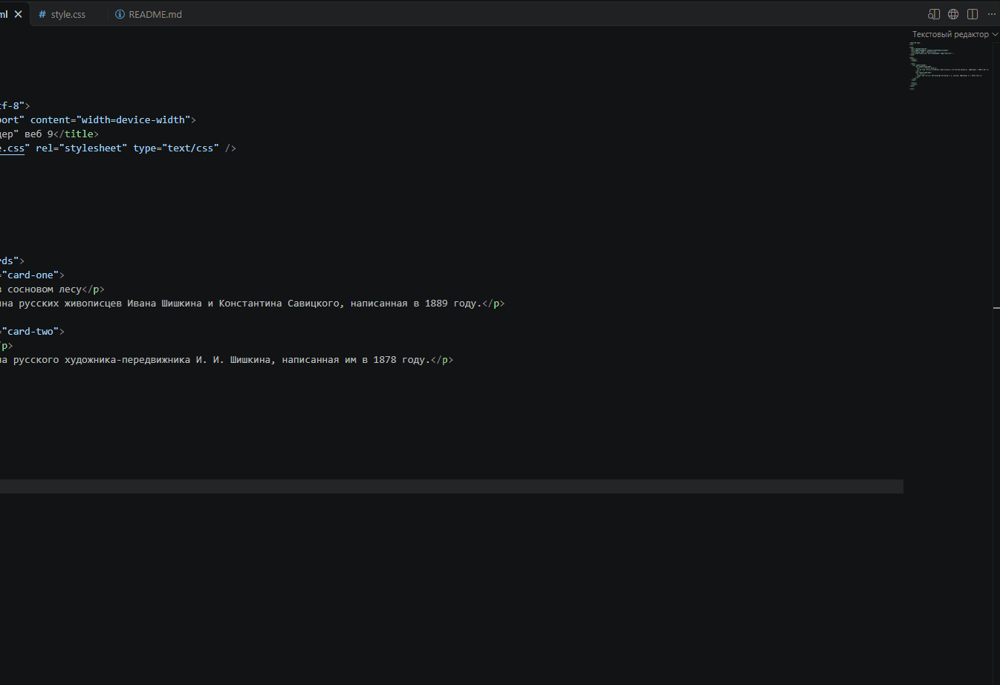

## Проект Интерактивные картины

## Описание проекта
Данный проект создан в рамках образовательного курса. При запуске проекта открывается меню с названием картин. При наведении покажется сама картина. При нажатии показывается набросок картин.

## Цель проекта
Это простой проект содержащий название и внешний вид картины.

## Используемые технологии
index.html:
- `div`-блок с классом `cards`. В этом блоке храняться все остальные `div`-блок.
- div-блок с классом `card-one`. В этом блоке хранится первая картина.
- `div`-блок с классом `card-two`. В этом блоке хранится вторая картина.
  
style.css:

Прописаны стили.

## Установка зависимостей
Нужно загрузить папку с проектом.

## Пример запуска
Для запуска проекта нужно открыть папку, а затем открыть index.html с помощью любого браузера.

Проект выполнен в образовательных целях на онлайн курсе "Основы web-разработки " школы Лидер".
